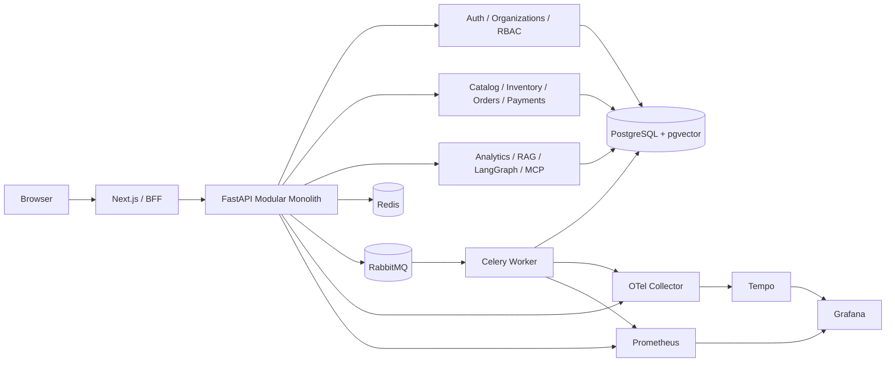

# NEXUS AI – Intelligent Multi-Tenant Business Management Platform

NEXUS AI là dự án portfolio mô phỏng một nền tảng SaaS quản trị doanh nghiệp đa tenant. Dự án tập trung vào năng lực Backend Python và AI Backend: transaction an toàn, tenant isolation, RBAC, asynchronous processing, RAG/AI Agent có kiểm soát, kiểm thử theo rủi ro và khả năng vận hành.

> Trạng thái: Task 01–28 đã hoàn thành ở mức repository; Task 29 hoàn thiện tài liệu portfolio. AWS staging đã có Terraform và workflow nhưng **chưa provision/deploy**. Repository không có public demo URL hoặc screenshot thực đã xác minh.

## Bài toán kinh doanh và giải pháp

Doanh nghiệp nhỏ thường phải ghép nhiều công cụ rời rạc cho catalog, tồn kho, đơn hàng, thanh toán, báo cáo và tri thức nội bộ. Điều này gây trùng dữ liệu, thiếu audit trail và khó kiểm soát quyền truy cập giữa các tổ chức.

NEXUS AI cung cấp một backend thống nhất theo Modular Monolith:

- Mỗi request/job được gắn tenant context từ danh tính đáng tin cậy, không nhận tenant ID tùy ý từ client.
- Order, Payment, Inventory dùng transaction, locking, idempotency và immutable audit history.
- Celery/RabbitMQ xử lý công việc nền; transactional outbox giữ consistency với PostgreSQL.
- RAG và LangGraph chỉ gọi tool allowlist có schema, authorization và audit; model không chạy SQL tùy ý.
- Next.js dashboard sử dụng API thật và hiển thị rõ loading, empty, error, authorization state.

## Chức năng đã triển khai

| Capability | Trạng thái |
|---|---|
| Authentication: Argon2id, JWT, refresh rotation/revocation, logout, password reset grant, rate limiting | Hoàn thành nền tảng |
| Multi-tenant Organization, Membership, Branch, invitation và active organization | Hoàn thành nền tảng |
| Tenant-scoped RBAC: Owner, Admin, Manager, Staff, Viewer | Hoàn thành nền tảng |
| Product/Category, generated SKU, Decimal pricing, soft delete | Hoàn thành |
| Inventory adjustment/transfer, atomic stock, immutable movement ledger | Hoàn thành |
| Order state machine, price snapshot, inventory deduction và rollback | Hoàn thành |
| Sandbox Payment, webhook HMAC, idempotency, refund model và financial audit | Hoàn thành nền tảng |
| Transactional outbox, idempotent consumer và reconciliation | Hoàn thành |
| Redis tenant-aware cache với fail-open fallback | Hoàn thành nền tảng |
| Celery/RabbitMQ reports, test notification, low-stock và outbox jobs | Hoàn thành nền tảng |
| Revenue analytics và asynchronous CSV/XLSX export | Hoàn thành nền tảng |
| PDF/TXT/Markdown ingestion, pgvector retrieval, citation và no-answer behavior | Hoàn thành nền tảng |
| LangGraph business assistant với năm read-only tools | Hoàn thành nền tảng |
| MCP adapter với bốn read-only analytics tools | Hoàn thành nền tảng |
| Next.js enterprise dashboard và AI/analytics workspace | Hoàn thành nền tảng |
| JSON logs, Prometheus, OpenTelemetry, Tempo, Grafana và alert rules | Hoàn thành local foundation |
| AWS staging | Cấu hình hoàn thành; **chưa deploy** |

Không có xử lý thẻ thật. Payment provider chỉ là sandbox. Email provider là test provider. Các khoảng trống được liệt kê tại [Giới hạn đã biết](#giới-hạn-đã-biết).

## Công nghệ

- Backend: Python 3.12+, FastAPI, Pydantic Settings, SQLAlchemy 2, Alembic.
- Data: PostgreSQL 17, pgvector, Redis.
- Async: Celery, RabbitMQ, transactional outbox.
- AI: OpenAI API, LangGraph, embeddings, RAG, MCP.
- Frontend: Next.js 16, React 19, TypeScript, Tailwind CSS.
- Quality: pytest, Ruff, mypy, Vitest, Playwright, Locust.
- Delivery: multi-stage Docker, GitHub Actions, Trivy, Terraform, AWS ECS Fargate.
- Observability: structured JSON logging, Prometheus, OpenTelemetry Collector, Tempo, Grafana.

## Kiến trúc



Backend là một deployment unit nhưng module ownership tách rõ. Framework nằm ngoài domain; transaction boundary nằm ở application/service; PostgreSQL là source of truth. Tổng quan chi tiết tại [docs/architecture/overview.md](docs/architecture/overview.md).

### Trade-off chính

- Modular Monolith thay microservices: giảm network/distributed transaction complexity, đổi lại cần kỷ luật module boundary.
- Pessimistic locking cho stock/order confirmation: ưu tiên consistency hơn write throughput cực cao.
- Transactional outbox: không mất event sau commit, đổi lại event chỉ đạt eventual delivery và cần idempotent consumer.
- Redis cache-aside fail-open: availability tốt hơn khi cache lỗi nhưng PostgreSQL có thể tăng tải.
- RAG dùng tenant filter trong persistence: giảm cross-tenant leakage; retrieval quality phụ thuộc chunking/embedding.
- ECS Fargate single-AZ staging: tiết kiệm vận hành/chi phí hơn Kubernetes, không phải kiến trúc HA production.
- OpenTelemetry sampling 10% ở staging: kiểm soát chi phí, có thể bỏ sót trace hiếm.

Các quyết định và cách trình bày trong phỏng vấn nằm tại [technical-decisions.md](docs/portfolio/technical-decisions.md).

## Cấu trúc repository

```text
nexus-ai/
├── .agents/skills/                 # 13 project skills + external playwright skill
├── .github/workflows/              # Skills, quality, delivery và staging deployment
├── backend/
│   ├── src/nexus/bootstrap/        # Composition root và Settings
│   ├── src/nexus/modules/          # Bounded business modules
│   ├── src/nexus/platform/         # DB, cache, jobs, reliability, telemetry
│   ├── migrations/                 # Alembic revisions
│   └── tests/                      # Unit, contract, integration, evaluation, performance
├── frontend/
│   ├── src/app/                    # App Router pages và BFF Route Handlers
│   ├── src/components/             # Reusable UI
│   ├── src/lib/                    # Typed API/auth utilities
│   ├── tests/                      # Vitest
│   └── e2e/                        # Playwright
├── infrastructure/
│   ├── docker/                     # Local Compose
│   ├── observability/              # Prometheus/Grafana/Tempo/OTel
│   └── terraform/                  # AWS staging IaC
├── docs/                           # Kiến trúc, security, runbook, portfolio
└── scripts/                        # Skills và coverage validators
```

## Chạy local bằng Docker Compose

### Yêu cầu

- Docker Desktop có Compose v2.
- Tối thiểu khoảng 8 GiB RAM khả dụng nếu chạy cả observability profile.
- Không cần cài PostgreSQL, Redis hoặc RabbitMQ trực tiếp.

### Khởi động application

```powershell
Copy-Item .env.example .env
# Mở .env và thay tất cả giá trị replace-with-* bằng secret local ngẫu nhiên.
docker compose --env-file .env -f infrastructure/docker/compose.yml config
docker compose --env-file .env -f infrastructure/docker/compose.yml build
docker compose --env-file .env -f infrastructure/docker/compose.yml up -d
docker compose --env-file .env -f infrastructure/docker/compose.yml ps
```

Backend container tự chạy `alembic upgrade head` trước Uvicorn; worker chỉ bắt đầu sau khi readiness pass.

| URL local | Mục đích |
|---|---|
| `http://127.0.0.1:3000` | Dashboard |
| `http://127.0.0.1:8000/api/v1` | API metadata |
| `http://127.0.0.1:8000/docs` | Swagger UI ngoài production |
| `http://127.0.0.1:8000/openapi.json` | OpenAPI schema |
| `http://127.0.0.1:8000/health/live` | Liveness |
| `http://127.0.0.1:8000/health/ready` | Readiness |

### Observability profile

```powershell
docker compose --env-file .env -f infrastructure/docker/compose.yml --profile observability up -d
```

Grafana chạy tại `http://127.0.0.1:3001`, Prometheus tại `http://127.0.0.1:9090`. Không expose các endpoint này ra Internet.

### Dừng local

```powershell
docker compose --env-file .env -f infrastructure/docker/compose.yml down
```

Lệnh trên giữ volume. Chỉ xóa volume khi đã backup và chủ động muốn reset dữ liệu; xem [database runbook](docs/database/local-development.md).

## Biến môi trường

`.env.example` là template duy nhất được commit. `.env` bị Git ignore.

| Nhóm | Biến quan trọng | Ghi chú |
|---|---|---|
| Runtime | `NEXUS_ENVIRONMENT`, `NEXUS_LOG_LEVEL`, `APP_PORT` | `production` tắt OpenAPI UI |
| PostgreSQL | `POSTGRES_*`, `DATABASE_URL` | Không dùng credential production ở local/test |
| Authentication | `JWT_SECRET_KEY`, token expiry, rate-limit settings | JWT secret tối thiểu 32 ký tự |
| Payment | `PAYMENT_WEBHOOK_SECRET` | Tách biệt JWT secret; sandbox only |
| Cache/jobs | `REDIS_URL`, `CELERY_BROKER_URL`, `CELERY_RESULT_BACKEND` | Tenant context vẫn được xác thực trước cache/job |
| AI | `OPENAI_API_KEY`, `OPENAI_MODEL`, `EMBEDDING_MODEL` | Để trống nếu không gọi OpenAI live |
| MCP | `NEXUS_MCP_*` | MCP không nhận tenant ID tùy ý |
| Telemetry | `OTEL_EXPORTER_OTLP_ENDPOINT`, sampling, Grafana password | Không capture body/header nhạy cảm |
| AWS CLI local | `AWS_PROFILE`, `AWS_REGION` | CI dùng OIDC, không dùng static access key |

## Database migration

```powershell
docker compose --env-file .env -f infrastructure/docker/compose.yml exec backend alembic current
docker compose --env-file .env -f infrastructure/docker/compose.yml exec backend alembic upgrade head
```

Migration chạy trên PostgreSQL disposable trong integration tests. Application rollback không tự downgrade schema; mặc định dùng expand-contract và roll-forward. Không chạy migration production nếu chưa có backup/review plan.

## API và demo

OpenAPI là contract chính tại `/openapi.json`; Swagger UI tại `/docs` chỉ bật ngoài production. Luồng demo có thể tái lập được mô tả trong [demo-script.md](docs/portfolio/demo-script.md), gồm authentication, tenant selection, Product/Inventory, Order/Payment, analytics và AI workspace.

Không có tài khoản demo hard-code hoặc production data. Mọi dữ liệu demo phải là synthetic.

## Agent Skills và Codex workflow

Repository có 13 skill nội bộ: `feature-delivery`, `project-planner`, `python-backend`, `api-design`, `database-design`, `security-review`, `test-engineering`, `frontend-engineering`, `ai-rag-engineering`, `agent-orchestration`, `devops-cloud`, `observability`, `documentation`.

Codex đọc `AGENTS.md`, chọn tập skill nhỏ nhất, đọc toàn bộ `SKILL.md`, thực hiện đúng một Task, chạy verification phù hợp và báo cáo bằng chứng. Skill registry/validator không chứng minh skill đã được runtime load trong mọi turn.

```powershell
python scripts/validate_skills.py
python -m unittest discover -s tests/skills -p "test_*.py" -v
```

Chi tiết invocation tại [usage-guide.md](docs/skills/usage-guide.md).

### External Skill

`playwright` được lấy từ official `openai/skills`, pin tại revision `49f948faa9258a0c61caceaf225e179651397431`, giữ Apache-2.0 license/notice. Không tự động chạy upstream script hoặc cài dependency chưa review. Cài đặt, audit, upgrade và rollback tại [external-skills.md](docs/skills/external-skills.md); nguồn chuẩn tại [registry.md](docs/skills/registry.md).

## Security design

- Argon2id password hashing; không lưu password/refresh token plaintext.
- JWT issuer/audience/expiry validation và opaque refresh rotation/replay revocation.
- Tenant context lấy từ authenticated membership; repository/service luôn scope organization.
- Permission allowlist và chống privilege escalation/last-owner removal.
- Idempotency, row lock, immutable audit và generic auth errors.
- HMAC webhook verification; không lưu card data.
- File type/size validation; retrieved content được coi là untrusted.
- AI/MCP tool authorization phía server; không model-generated SQL.
- Telemetry không chứa token, prompt, document, raw SQL hoặc tenant/user ID.

Threat model, checklist và remediation còn mở tại [docs/security/](docs/security/). “Hoàn thành audit” không có nghĩa ứng dụng hoàn toàn an toàn.

## AI, RAG và MCP

RAG ingestion xác thực tenant/document, trích PDF/TXT/Markdown, chunk, embed và lưu pgvector. Retrieval luôn có tenant filter, answer kèm citation hoặc trả no-answer rõ ràng. Chi tiết tại [rag-knowledge-base.md](docs/architecture/rag-knowledge-base.md).

LangGraph agent có explicit state transitions và năm read-only tools: revenue, top products, inventory alerts, period comparison và knowledge search. Tool input/output typed, timeout, authorization và immutable audit. Xem [business-intelligence-agent.md](docs/architecture/business-intelligence-agent.md).

MCP adapter chỉ expose bốn approved analytics tools, xác thực NEXUS JWT và resolve active tenant phía server. MCP không expose database operation. Xem [mcp-integration.md](docs/architecture/mcp-integration.md) và [evaluation-task22.md](docs/ai/evaluation-task22.md).

## Testing và kết quả thực tế

Test strategy không dùng coverage percentage làm bằng chứng duy nhất:

- Unit/contract cho domain, validation, API error và telemetry privacy.
- PostgreSQL integration cho migration, transaction, tenant/RBAC và rollback.
- Concurrency cho SKU, stock, order confirmation và payment webhook.
- AI evaluation cho retrieval, no-answer, citations, tool selection và tenant isolation.
- Vitest/Playwright cho frontend component và responsive browser flow.
- Locust dùng synthetic workload cho HTTP baseline.

Kết quả đã thực thi gần nhất:

| Suite | Kết quả |
|---|---|
| Backend full PostgreSQL suite tại Task 26 | 113 pass, 3 Redis tests skip; coverage tổng 89% |
| Backend deterministic regression tại Task 28 | 65 pass, 58 integration/performance deselected |
| Database telemetry integration tại Task 28 | 2 pass |
| Frontend Vitest tại Task 26 | 16 pass |
| Playwright Chromium tại Task 26 | 2 pass |
| Observability/health focused suite | 12 pass |

Chi tiết command và coverage gates tại [quality-verification.md](docs/testing/quality-verification.md). Các kết quả ở những thời điểm khác nhau không được cộng lại thành một tổng giả.

## CI/CD và deployment

- `quality-verification.yml`: Ruff, mypy, pytest/coverage, frontend typecheck/lint/test/build/E2E và load smoke.
- `delivery-validation.yml`: build multi-stage images, Trivy HIGH/CRITICAL gate, Compose và Terraform validation.
- `deploy-staging.yml`: manual GitHub Environment approval, short-lived AWS OIDC, immutable Git SHA image, migration trước ECS service update.

Terraform định nghĩa HTTPS ALB, ECS Fargate, RDS PostgreSQL, ElastiCache Redis, Amazon MQ, ECR, CloudWatch Logs và Secrets Manager integration. Không có AWS resource nào được tạo trong repository task. Xem [AWS staging architecture](docs/architecture/aws-staging.md) và [deployment/rollback runbook](docs/deployment/staging-runbook.md).

## Performance benchmark

Locust baseline Task 26 trên cùng máy, 25 synthetic clients, 20 giây, chỉ đo `/health/live` và `/api/v1`:

| Throughput | p50 | p95 | p99 | Error rate |
|---:|---:|---:|---:|---:|
| 168,72 req/s | 3 ms | 7 ms | 10 ms | 0% |

Đây không phải production capacity và không đo PostgreSQL/auth/business workflow. Hardware, CSV gốc và giới hạn tại [task26-benchmark.md](docs/performance/task26-benchmark.md).

## Troubleshooting

| Hiện tượng | Kiểm tra |
|---|---|
| Backend không ready | `docker compose ... ps`, PostgreSQL health, `DATABASE_URL`, migration log |
| PostgreSQL báo `password authentication failed` sau khi đổi `.env` | Volume có thể đã được khởi tạo bằng credential cũ. Khôi phục đúng credential hoặc backup rồi reset theo [database runbook](docs/database/local-development.md); không tự ý xóa volume |
| Login luôn thất bại | JWT secret/issuer/audience, user active, rate-limit window; không log token |
| Frontend báo backend unavailable | `API_BASE_URL`, backend readiness và BFF route `/api/backend/health` |
| Job không chạy | RabbitMQ health, worker health, durable job status/dead-letter và correlation ID |
| Cache lỗi | Redis health; API phải fallback PostgreSQL, đồng thời theo dõi DB load |
| AI trả no-answer | Document status, tenant permission, chunks, threshold và citation evidence |
| Metrics/traces trống | `/metrics`, scrape targets, `OTEL_EXPORTER_OTLP_ENDPOINT`, collector/Tempo health |

Incident procedure đầy đủ tại [observability-runbook.md](docs/operations/observability-runbook.md).

## Giới hạn đã biết

- Chưa có public deployment, public demo URL hoặc screenshot xác minh.
- AWS staging single-AZ và chưa provision; không phải production HA.
- Alertmanager/on-call notification, WAF, autoscaling và disaster-recovery exercise còn **PLANNED**.
- Redis integration đã từng bị skip khi service không có; cần chạy lại full suite trong môi trường CI/service đầy đủ.
- Backend Python chưa có transitive lockfile đa nền tảng.
- Payment/email chỉ là sandbox/test provider.
- Account update và một số Payment history UI contract chưa có backend tương ứng.
- AI quality/cost phụ thuộc provider/model; evaluation hiện dùng dataset giới hạn và deterministic doubles khi phù hợp.
- Performance mới là HTTP baseline ngắn, chưa phải authenticated business load/soak test.

## Roadmap

Task 01–28 đã xây dựng application foundation; Task 29 hoàn thiện portfolio documentation. Task 30 **PLANNED** tập trung final audit, cleanup, reproducibility gaps, end-to-end demo verification và release readiness. Lộ trình chi tiết tại [30-tasks.md](docs/roadmap/30-tasks.md).

## Tài liệu dành cho phỏng vấn

- [Interview guide](docs/portfolio/interview-guide.md): cách giải thích hệ thống, câu hỏi và bằng chứng.
- [Technical decisions](docs/portfolio/technical-decisions.md): quyết định, lựa chọn thay thế và trade-off.
- [Demo script](docs/portfolio/demo-script.md): kịch bản demo synthetic, expected result và fallback.

## Trạng thái

**29/30 Task** sau khi tài liệu Task 29 được xác minh. Mọi claim trong README đều gắn với code, test hoặc tài liệu trong repository; capability chưa kiểm chứng được đánh dấu **PLANNED**, chưa deploy hoặc giới hạn đã biết.
